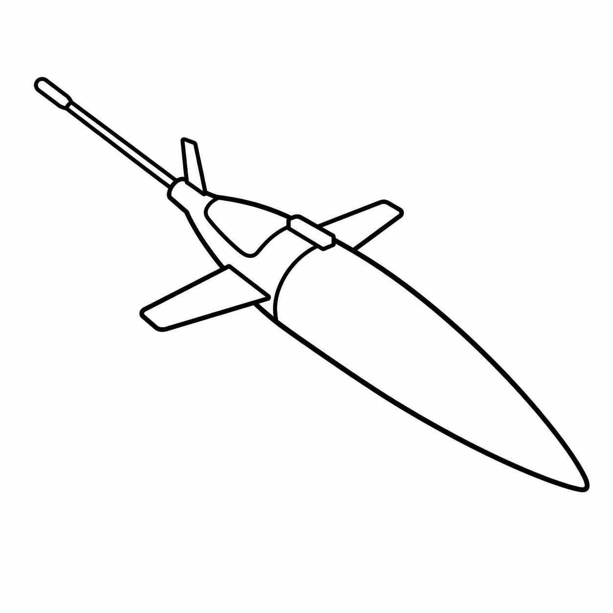

# Data Management

What happens to glider data after it leaves the vehicle: decoding and
processing, quality control, and preparing data for users and data
assembly centres. The processing chain differs a lot between platforms,
so the pages are organised by glider.

## Platforms

-   { .platform-icon }

    **Seaglider**

    ---

    How the basestation processes and quality-controls each dive, and how to review and correct the result.

    [:octicons-arrow-right-24: Seaglider Data Management](seaglider/index.md)

