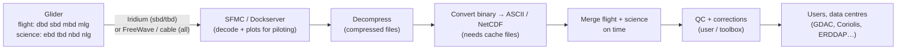

# Data Processing & QC

Unlike a Seaglider, whose basestation QC's every dive automatically (see
[Seaglider Data Quality Control](../seaglider/data-qc.md)), a Slocum has
**no built-in data QC**. The glider records raw sensor values in compact
binary files. The SFMC (or older Dockserver) decodes and plots them for
piloting. Everything else is up to the user: converting the files, merging
flight and science data, quality control and corrections. Teledyne itself
describes the SFMC as a piloting and viewing tool, not the place for
full-mission analysis.

The good news is that the community has built a solid open-source
toolchain for this. This page walks through the chain from the glider's
files to QC'd data.

!!! info "Source"
    Paraphrased from the Teledyne Webb Research *Slocum G3 Glider Operators
    Manual* (science data logging and data retrieval chapters), the Slocum
    `masterdata`, Teledyne's *Processing Binary Glider Data Outside of the
    SFMC* notes and file-compression notes, the Webb Research glider forum
    (data processing, cache-file and merging threads), the UG2 Slack #data,
    #general and #piloting channels (2022–2026), and operator
    correspondence. Tool behaviour changes between releases: check each
    tool's documentation, and defer to Teledyne for the glider side.

---

## The data flow at a glance

| Stage | Who does it | Tools |
|---|---|---|
| Logging | Glider (flight and science processors) | `sbdlist.dat` / `tbdlist.dat` etc. choose what goes in the small files |
| Transfer | Pilot / SFMC | Iridium for the small files during the mission, FreeWave or the direct cable for full files |
| Decode for piloting | SFMC | Plots and ASCII, mainly for flying the glider |
| Convert, merge | User | Teledyne executables, dbdreader, dbd2netcdf, pyglider… |
| QC and corrections | User | ioos_qc, SOCIB toolbox, EGO/Coriolis decoder, own scripts |
| Distribution | User / data centre | GDAC, Coriolis, ERDDAP |

---

## The files

Each processor writes its own set of files with the same name root. Flight
and science files come in matching pairs and share the same format:

| Flight | Science | Contents |
|---|---|---|
| `.dbd` | `.ebd` | Full data: every sensor turned on for logging. Large; normally recovered after the mission or over FreeWave |
| `.sbd` | `.tbd` | Short subset: only the sensors listed in `sbdlist.dat` / `tbdlist.dat`. What you normally get over Iridium during a mission |
| `.mbd` | `.nbd` | A second user-defined subset (`mbdlist.dat` / `nbdlist.dat`) |
| `.mlg` | `.nlg` | Mission log: behaviours and device events (text) |

With **file compression** on (`u_use_file_compression`, default on for G3S
gliders from software 10.05), the extensions change: `.dcd`, `.ecd`,
`.scd`, `.tcd`, `.mcd`, `.ncd`, `.mcg`, `.ncg`, and `.ccc` for cache files.
Compressed full files are roughly half the size; compressed short files
about 20 % smaller. Scripts that ask for `*.sbd *.tbd` must ask for
`*.scd *.tcd` instead. One operator found 8 GB cards on each processor
ample for a 45–60 day mission with compression on.

Files copied straight off the cards have short 8.3 names
(`01180000.dcd`). Rename them to the long form (glider name, year, day,
mission and segment number) before processing; Teledyne's
`rename_dbd_files` does this.

!!! warning "Real-time files are a subset, and possibly undersampled"
    The `sbd`/`tbd` lists can decimate each sensor (e.g. one value every
    120 s). That keeps Iridium costs down but can **alias** fast signals:
    one team saw a heading record that looked like slow drift when the
    glider was actually spiralling. For diagnosis, temporarily raise the
    sample rate in the list, or wait for the full `dbd` data.

### Cache files

To save transmission, binary files don't carry their own column headers
every time. The header (the list of sensors, their sizes and units) lives
in a separate **cache file** (`.cac`, named by a checksum), kept on the
glider in `state/cache` on both processors. Whether the header is sent
with a file is set by `u_dbd_sensor_list_xmit_control` and
`u_sci_dbd_sensor_list_xmit_control`. The default sends it only if this
glider hasn't sent it before.

- **A missing cache file is the most common reason a file won't
  process.** The SFMC marks such files and says which cache file is
  missing. Copy it from the glider's `state/cache` into the server's cache
  directory (on older Dockservers `/var/opt/dataserver/dataFiles/cache/`,
  then restart the data server).
- Cache files depend on the **software version and sensor list**, not on
  the individual glider. They are not glider-specific secrets, but after a
  software update new ones appear.
- **Keep every cache file with the mission data.** Without them the
  binary files can't be decoded. Some missions have the header only in
  the first files of a deployment, so a processing tool must be able to
  pick it up from there.

---

## Getting the files

- **During the mission:** the glider sends what the surface dialog or
  scripts ask for, usually the short files over Iridium. Full `dbd`/`ebd`
  files are too large for Iridium in most cases but can be pulled over
  FreeWave when the glider is close (e.g. after test dives at deployment).
- **After recovery:** download everything over the high-speed direct
  cable. With the glider safely out of the water and in lab mode, drop to
  the shell (and on the science side, boot science to its shell), switch
  on high-speed transfer and zmodem-send the `logs`, `sentlogs`, `config`,
  `missions`, `mafiles`, `state` and `state/cache` folders from both
  processors. Afterwards switch high speed off and set the glider back to
  boot the application before it is deployed again.
- **From the SFMC automatically:** a community Python package wraps the
  SFMC API (list and download files per glider, monitor call-ins). On your
  own SFMC server an `rsync` of the data directory triggered by new files
  works too. Don't loosen permissions on the SFMC data directories without
  understanding the consequences; it has taken servers down.

---

## Decompress, convert and merge

### With Teledyne's tools

Teledyne provides command-line executables for Windows and Linux (from the
Webb Research data host):

1. **Decompress** compressed files: `compexp x <input> <output>`.
2. **Rename** 8.3 files: `rename_dbd_files *.*`.
3. **Convert** each binary file to ASCII, pointing at the cache folder:
   `dbd2asc -c <cache_dir> <file>.dbd > <file>.dba`, and the same for
   the `.ebd`.
4. **Merge** flight and science: `dba_merge <file>.dba <file>.eba`.
5. Optionally **filter** to the sensors you need
   (`dba_sensor_filter -f sensorlist.txt`) and convert to a MATLAB file
   (`dba2_glider_data`).

Batch these in a script; a mission has hundreds of segments. If MATLAB runs
out of memory, process segment pairs separately or filter the sensor list
first.

### Merging flight and science data

The two processors keep separate clocks. Each logs its own time
(`m_present_time` on flight, `sci_m_present_time` on science), and the
merge lines records up on time. The difference is tracked in
`m_science_clothesline_lag`. The glider re-syncs the science clock
automatically (older releases did it when the lag passed
`u_max_lag_before_syncing_time`, then 12 s). For high timing accuracy, sync
before the mission and check the lag in post-processing.

- **`m_present_time` must be in the flight lists and
  `sci_m_present_time` in the science lists** (`sbdlist`/`tbdlist`,
  `mbdlist`/`nbdlist`). They aren't added automatically, and without them
  the merge fails with "Unknown sensor: sci_m_present_time". One team
  rescued such a deployment by filtering both files with
  `dba_sensor_filter` before merging.
- For time-critical work (thermal-lag correction), use the **instrument's
  own timestamp** (e.g. `sci_ctd41cp_timestamp` for the Sea-Bird CTD),
  not `sci_m_present_time`. The latter is when the science processor
  woke up, not when the CTD measured. Make sure the CTD is set to send
  its timestamp field (`c_ctd41cp_num_fields_to_send` 4, the current
  default). Depending on the CTD rate and the science cycle, some CTD
  samples may never be logged at all.

### Community tools

| Tool | Language | What it does |
|---|---|---|
| **dbdreader** | Python (C core) | Reads the binary files directly, no ASCII step; handles cache files; includes a decompression function |
| **dbd2netcdf** | C++ | Converts (compressed) binary files to NetCDF; recovers data from partly corrupted files up to the first bad record |
| **pyglider** | Python | Converts raw files (via dbdreader) into CF-style NetCDF time series and depth-time grids, with metadata from a YAML file. Aimed at GDAC submission. **Does no QC** |
| **GUTILS** | Python | Older pipeline for converting Slocum data to IOOS GDAC NetCDF |
| **SOCIB glider toolbox** | MATLAB/Octave | Full chain for Slocum and Seaglider: conversion, thermal-lag correction, basic QC, figures. Old but still used |
| **EGO / Coriolis decoder** | MATLAB | Produces EGO-format NetCDF for the European (Coriolis) data centre, with QC |
| **GliderTools** | Python | Post-processing, QC and gridding of NetCDF data; now largely platform-independent despite its Seaglider origins |
| **ioos_qc** | Python | The IOOS QARTOD tests (below) on processed NetCDF data |
| Teledyne `dbd2csv` | Python 2 | Simple converter released by Teledyne on the forum; dated |

A browser-based Slocum decoder and a TEOS-10 seawater calculator are also
available from the community for quick looks.

!!! tip "Corrupted compressed files"
    A few compressed science files (20 of 324 in one mission) failed to
    decompress with `compexp` (LZ4 "corrupt input" error) although the
    SFMC could open them. Things to try: a current `liblz4`, dbdreader's
    decompression function, or dbd2netcdf, which salvages the good records.

---

## What the glider does onboard

The glider's own checks protect its flight, not your data, but they leave
traces worth knowing:

- **Depth filter.** Pressure readings implying an impossible depth rate
  are rejected (`m_depth_rejected`, cut-off set by
  `u_depth_rate_filter_factor`). Rejected readings leave gaps in `m_depth`.
- **GPS status.** Every fix carries a status (`m_gps_status`,
  `m_gps_full_status`): 0 is a valid fix; other values mean the fix was
  ignored, flagged invalid by the receiver, or a "best guess" reusing an
  earlier fix. By default (`u_update_gps_with_invalid` 1) an invalid fix
  can still be published as `m_gps_lat/lon` when nothing better is
  available.
- **Placeholder values.** Position sensors start at **69696969** until a
  real value exists. Treat it as missing.
- **The CTD pump** won't start until the conductivity frequency is above
  its threshold (`mincondfreq`, about 3000 Hz, i.e. roughly 25 PSU or
  more depending on calibration). That protects the pump, but in fresh
  water the CTD won't pump unless the threshold is lowered.

---

## What you have to QC and correct

### Read the binary format correctly first

- **NaN means "no new value", not "bad".** A binary file stores a sensor
  only when it has a new value, so the merged table is mostly NaN. Don't
  interpolate or forward-fill without thinking about what each sensor is.
- **The first record can hold initial values.** With `dbd2asc -o` (and in
  some files even without it) the first data line contains initial or
  default values, some unrealistic. Mission `sensor:` settings are written
  as initial values in the first segment, not as later records.

### Units

| Sensor | Logged as | Watch out |
|---|---|---|
| `sci_water_cond` | S/m | Seawater routines (TEOS-10 `SP_from_C`) want **mS/cm**: multiply by 10 |
| `sci_water_pressure` | **bar** | Multiply by 10 for dbar |
| `m_pressure` | bar | Flight pressure sensor |
| `m_gps_lat`, `m_gps_lon` | **DDMM.MMMM** | Degrees and minutes run together; convert to decimal degrees |
| `m_lat`, `m_lon` | DDMM.MMMM | Dead-reckoned estimate, not a fix |
| RBR legato channels | mS/cm, dbar natively | The proglet's mapped `sci_water_*` channels are converted to S/m and bar |

In mid-2026 the US glider data centre had deployments whose conductivity
was labelled S/m but held values a factor of 10 off, which made salinity and
density absurd (density inversions through the whole water column, surface
density no real water could have). Check units against the actual numbers,
not just the metadata.

!!! note "Name your density"
    In CF conventions `sea_water_density` means **in-situ** density.
    Potential density is `sea_water_potential_density` (or
    `sea_water_sigma_theta` without the 1000). Data centres have received
    both under one name. Say which in the `long_name` too.

### Pressure and depth

- **Use the CTD pressure for science**, not `m_depth`. `m_depth` comes from
  the flight pressure sensor elsewhere on the hull; with pitch the two
  differ by around a metre, plus any clock offset between processors.
- **A growing difference is a sensor problem.** One mission showed the CTD
  depth falling behind `m_depth` with depth (about 10 m at 200 m, 30 m at
  900 m) and recovering on the climb. Suspects: something stuck in or over
  a pressure port (silicone grease has done it), a sensor out of
  calibration, or a wrong flight-pressure calibration (compare
  `m_pressure_voltage` with CTD pressure). One team routinely compares the
  two pressures, corrected for pitch, roll and sensor positions, to
  recalibrate the flight sensor against the CTD.

### Positions

Underwater positions are estimates. Most toolboxes **interpolate between
GPS fixes over time**, rather than using the glider's dead-reckoned `m_lat`
/ `m_lon`. Points before the first or after the last fix of a stretch
can't be interpolated and end up as fill values (one toolbox used 99999);
handle them as missing. Filter fixes by `m_gps_status` first, and drop
69696969.

The glider's depth-averaged current estimate (`m_water_vx`, `m_water_vy`)
is computed at surfacing for the previous segment.

### CTD thermal lag and dive/climb differences

The conductivity cell responds more slowly to temperature than the
thermistor, so salinity is biased in sharp thermoclines, in opposite
directions on dives and climbs. Expect pycnocline depths to differ by
0.5–2 m between dive and climb before correction.

- The standard correction (Garau et al., 2011) adjusts the temperature
  used to compute salinity, choosing parameters that minimise the area
  between dive and climb T–S profiles. It was developed for unpumped CTDs;
  for pumped CTDs the flow speed is nearly constant, and a manufacturer
  timing offset is a first approximation. Implementations range from
  per-profile-pair to per-deployment fits.
- Compute time derivatives with the **CTD timestamp**.
- Internal waves also move the pycnocline between profiles (1–3 m was
  typical in one coastal area), so judge a correction statistically: on a
  long virtual mooring, a good correction left dive/climb pycnocline
  differences averaging within about ±0.2–0.3 m.
- **Growing dive/climb salinity differences mid-mission** usually mean a
  partly blocked conductivity cell (biology in the plumbing) or a failing
  pump, not a processing problem. Look at raw conductivity around
  inflections. It often clears at sea, but not always.

### Oxygen optodes

The optode has a large thermal lag. Logging the **phase** output lets you
recompute oxygen shoreside with the CTD temperature, and apply the
salinity and pressure compensation the optode does not do itself.

### Automated QC: QARTOD

The US IOOS **QARTOD** manual for glider temperature and salinity (2016) defines
the standard real-time tests, and `ioos_qc` implements them:

| Group | Tests |
|---|---|
| Required | Timing/gap, syntax, location, gross range, climatology |
| Strongly recommended | Spike, rate of change, flat line |
| Suggested | Multi-variate, attenuated signal, neighbour, T–S curve, density inversion |

Flags: 1 pass, 2 not evaluated, 3 suspect, 4 fail, 9 missing. Operators
often start with gross range, spike and location tests. The timing/gap and
syntax tests fit streaming data and are less useful when the pilot already
knows why data is late.

The US glider data centre now reads QARTOD aggregate flags for temperature
and salinity and passes them on with the data to the global weather
network.

---

## Real-time vs delayed mode

| | Real time | Delayed mode |
|---|---|---|
| Input | `sbd`/`tbd` subsets, decimated | Full `dbd`/`ebd` after recovery |
| Goal | Piloting, quick data to users and forecast models | Best possible science data |
| QC | Automated tests only | Automated tests, corrections (thermal lag, calibration offsets, sensor alignment) and expert review |
| File names (US GDAC) | `glider_yyyymmddTHHMMSSZ.nc` | `..._delayed.nc` |

Delayed-mode work takes judgement: even for the same glider in the same
area, correction constants have to be checked again for drift, and someone
experienced must decide whether the corrected data is actually better.

---

## Pitfalls

- **Missing cache files**: archive them with every mission.
- **`sci_m_present_time` missing from the science lists**: the merge fails.
- **Wrong conductivity units**: a factor-of-10 salinity error.
- **`m_gps_lat` used as decimal degrees**: positions off by a lot.
- **69696969 and fill values left in**: wild positions on maps.
- **Decimated real-time data treated as complete**: aliasing.
- **Compressed files fed to tools that don't decompress them**.

---

## See also

- [Seaglider Data Quality Control](../seaglider/data-qc.md): how the Seaglider basestation does all of this automatically
- [Slocum Iridium](../../glider-components/slocum/iridium/index.md): call-ins and data transfer
- [Slocum FreeWave](../../glider-components/slocum/freewave/index.md): pulling full files at close range
- [Slocum Mission Files](../../piloting/slocum/mission-files.md): mission setup
