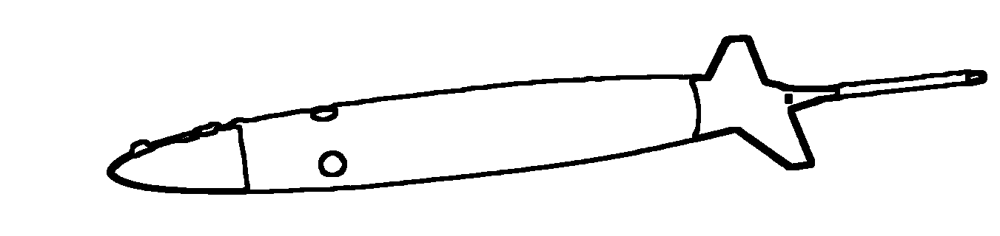

# SeaExplorer Piloting

<!-- { .platform-banner } -->
{ .platform-banner }

Piloting documentation for the SeaExplorer platform.

## In This Section

-   :material-note-text-outline: **Test**

    ---

    Testing testing 1, 2, 3.

    [:octicons-arrow-right-24: Test](test.md)

